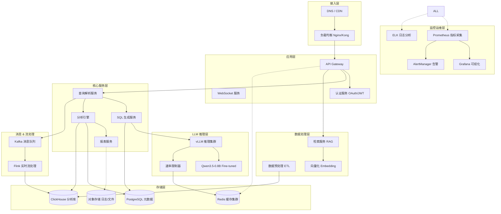
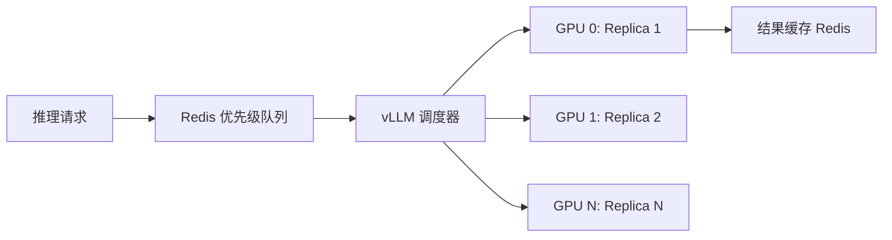
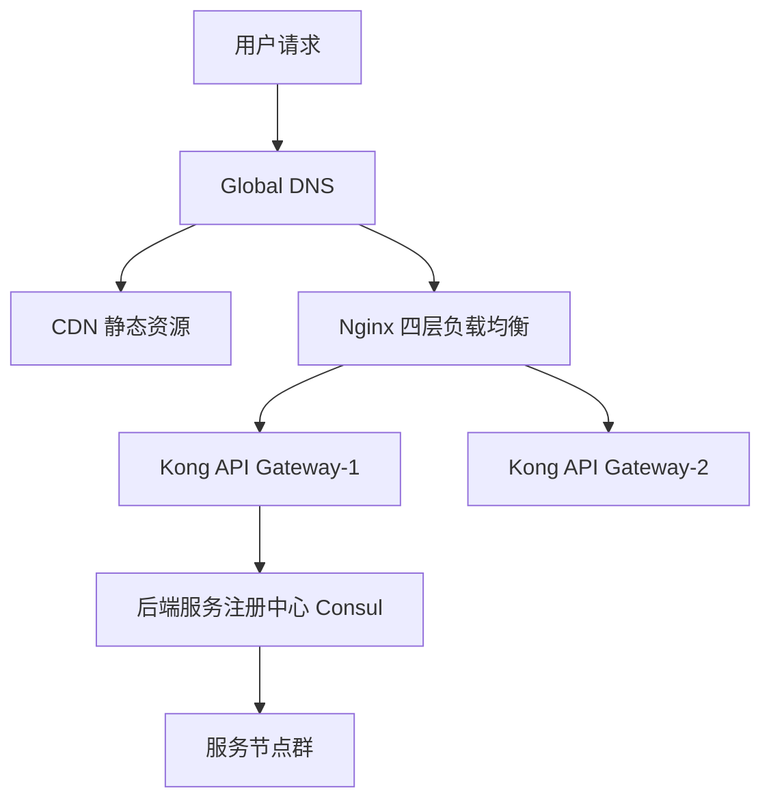
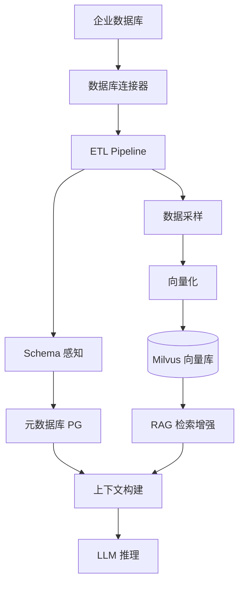
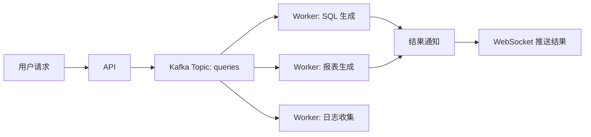
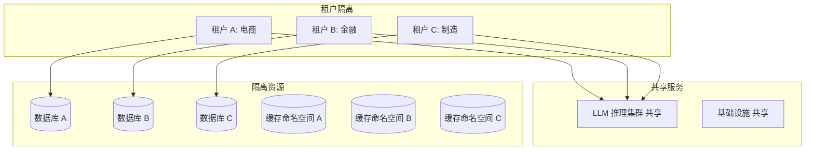
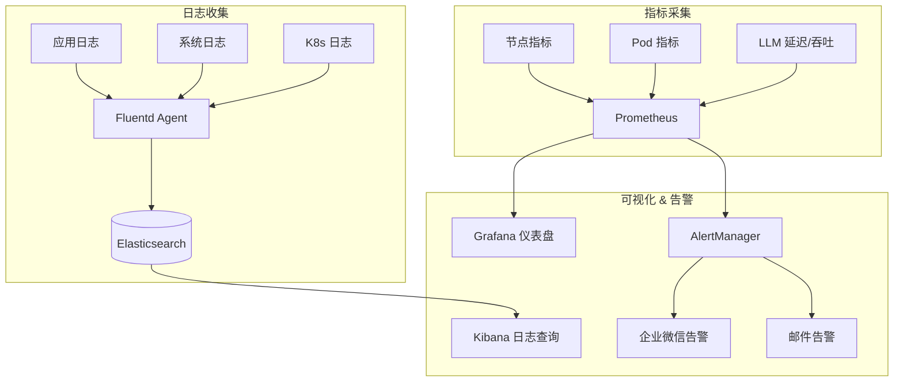
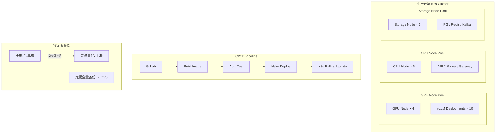

# Q2.2 系统架构设计文档：DataLens AI

> 目标：设计支持 **10 万级并发**的工业级 LLM 应用部署架构，涵盖推理引擎、数据处理、数据库、缓存、消息队列、负载均衡、监控运维等模块。

---

## 1. 架构总览

---

## 2. 各模块详细设计

### 2.1 LLM 推理层

**选型**：vLLM + Qwen3.5-0.8B (fine-tuned)

| 配置项 | 规格 | 说明 |
|--------|------|------|
| 推理框架 | vLLM v0.6+ | 支持 PagedAttention、Continuous Batching |
| 模型 | Qwen3.5-0.8B | 显存需求约 2GB/实例 |
| GPU 节点 | 8× NVIDIA A10/L20 | 每节点 24-48GB 显存 |
| 并发吞吐 | ~5000 tokens/s per GPU | vLLM batching 可提升 10-20x 吞吐 |
| 副本数 | 10+ | Kubernetes HPA 自动扩缩容 |
| 量化 | AWQ 4-bit (可选) | 进一步降低显存需求 |

**并发计算**：假设每条请求生成 500 tokens，单 GPU 可处理 10 条/秒并发请求。10 个 GPU 副本 = 100 req/s 实时处理。配合请求队列（Kafka），可将突发流量缓冲，峰值支持 10 万并发连接的请求排队处理。

**优化策略**：
- **Continuous Batching**：动态批处理，吞吐提升 10x
- **KV Cache 复用**：相同前缀的请求共享 KV 缓存（适用于多轮对话）
- **请求优先级**：付费用户高优先级，通过 Redis Sorted Set 实现
- **结果缓存**：高频重复查询（如"本月销售额"）缓存 5-30 分钟

---

### 2.2 负载均衡 & API 网关

| 组件 | 选型 | 功能 |
|------|------|------|
| DNS | 阿里云 DNS / Cloudflare | 全球流量调度 |
| L4 负载均衡 | Nginx / HAProxy | TCP 层连接分发，10 万+ 并发连接 |
| API 网关 | Kong / APISIX | 认证、限流、路由、日志、插件 |
| 服务发现 | Consul / K8s Service | 服务注册、健康检查 |

**并发设计**：
- Nginx 单机可处理 10 万+ 并发连接（worker_connections 65535 × worker_processes 4）
- Kong 集群水平扩展，无状态设计
- K8s HPA 根据 CPU/内存/QPS 自动扩缩 Pod

---

### 2.3 数据处理层

**数据安全**：
- **私有化部署模式**：所有数据处理在企业内网完成，不出网
- **数据脱敏**：敏感字段自动识别 + 脱敏（正则 PII 检测）
- **审计日志**：所有 SQL 执行记录留底，支持合规审计

---

### 2.4 存储层设计

| 存储 | 选型 | 用途 | 容量规划 |
|------|------|------|---------|
| 关系型 | PostgreSQL 14+ | 用户、租户、订阅、配置 | 主从，SSD 500GB |
| 分析型 | ClickHouse | 查询日志、统计聚合、用户行为 | 集群，SSD 2TB |
| 缓存 | Redis 7 Cluster | 会话、限流计数器、查询结果缓存 | 3 主 3 从，64GB |
| 向量 | Milvus | Schema 向量索引（RAG） | 单节点 128GB |
| 对象 | MinIO / S3 | 报表文件、日志归档、模型备份 | 无限扩展 |

---

### 2.5 消息队列 & 异步处理

- **Kafka**：解耦前端请求和后台处理，削峰填谷
- **异步处理**：耗时操作（报表生成、大表查询）通过消息队列异步执行，不阻塞用户
- **WebSocket**：长连接推送任务进度和结果，避免用户轮询

---

### 2.6 多租户架构

- **数据隔离**：每个租户独立数据库 Schema，查询结果通过 Redis namespace 隔离
- **计算共享**：LLM 推理资源池化共享，提高 GPU 利用率
- **计费计量**：按 token 使用量 + API 调用次数计费

---

### 2.7 监控运维层

**关键监控指标**：

| 分类 | 指标 | 告警阈值 |
|------|------|---------|
| LLM | P50/P99 推理延迟 | P99 > 5s 告警 |
| LLM | Token 吞吐量 (tokens/s) | 低于基线 50% 告警 |
| API | QPS | 超过容量 70% 触发扩容 |
| API | 错误率 5xx | > 1% 告警 |
| 数据库 | 连接数、慢查询 | 连接 > 80% 告警 |
| 资源 | GPU 利用率 | < 30% 或 > 95% 告警 |
| 资源 | 内存 / 磁盘使用率 | > 85% 告警 |
| 业务 | 客户活跃度 DAU | 下降 30% 告警 |

---

## 3. 10 万并发技术方案

### 3.1 并发路径分析

用户请求 → Nginx（10 万连接）→ Kong Gateway（无状态，水平扩展）→ 后端服务（K8s HPA）→ Kafka 缓冲 → LLM 推理集群

### 3.2 各层并发承载能力

| 层级 | 单节点能力 | 集群规模 | 理论峰值 |
|------|-----------|---------|---------|
| Nginx L4 | 100K 连接 | 2 节点（主备） | 200K |
| Kong Gateway | 10K QPS | 5 节点 | 50K QPS |
| Redis Cluster | 100K ops/s | 6 节点 | 600K ops/s |
| Kafka | 100K msg/s | 3 broker | 300K msg/s |
| vLLM GPU | 10 req/s | 10 GPU | 100 req/s 实时 + 缓冲 |

### 3.3 应对突发流量

1. **Kafka 缓冲**：突发请求进入 Kafka 队列，平滑消费
2. **HPA 自动扩容**：GPU 节点根据 vLLM 队列深度自动扩缩
3. **降级策略**：超过容量时，非 VIP 用户进入排队等待，展示预估等待时间
4. **熔断**：下游服务异常时自动熔断，返回友好提示而不崩溃

---

## 4. 部署架构

---

## 5. 成本估算

| 资源 | 规格 | 数量 | 月成本（云） |
|------|------|------|-------------|
| GPU 节点 | A10 × 8 | 4 台 | ¥32,000 |
| CPU 节点 | 32C 64G | 6 台 | ¥12,000 |
| 存储节点 | SSD 2TB | 3 台 | ¥6,000 |
| 对象存储 | 10TB | - | ¥2,000 |
| 网络带宽 | 100Mbps BGP | - | ¥3,000 |
| 其他（K8s/监控/备份）| - | - | ¥5,000 |
| **合计** | | | **¥60,000/月** |

即每 1000 个月活用户的月度基础设施成本约 ¥12,000。

---

*本文档使用 Claude (Anthropic) 辅助撰写。提示词：*
1. "设计一个支持 10 万并发的 LLM 应用系统架构，包含推理引擎、数据处理、负载均衡、消息队列、监控等模块"
2. "使用 Mermaid 语法绘制系统架构图，涵盖接入层、应用层、LLM 推理层、存储层、监控层"
3. "计算 10 万并发场景下各层级的资源需求和成本估算"
4. "设计多租户 SaaS 架构中的数据隔离和计费方案"
