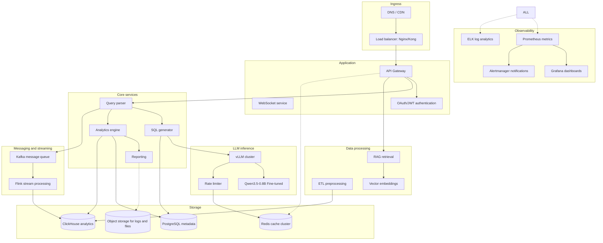
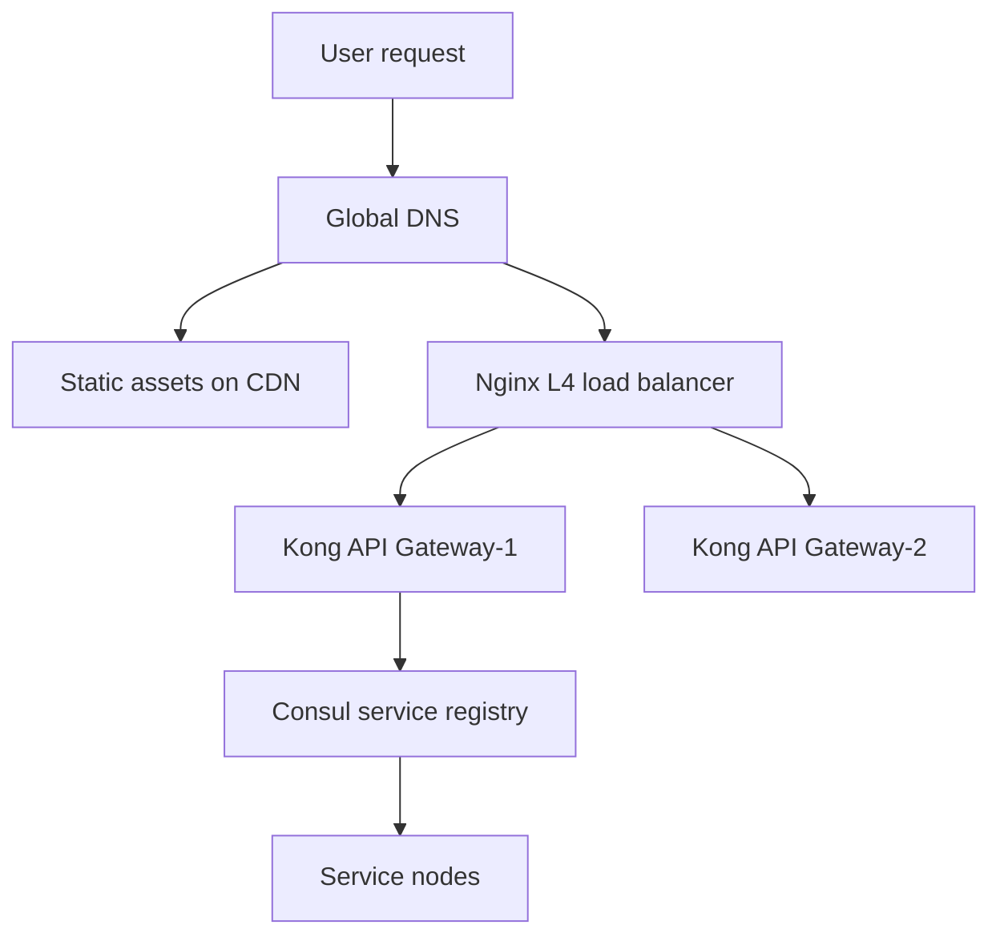
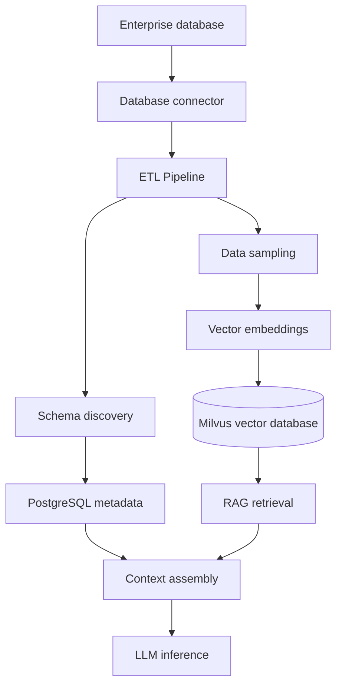
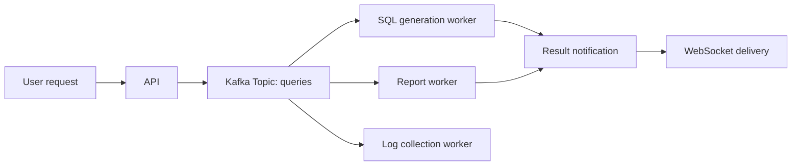
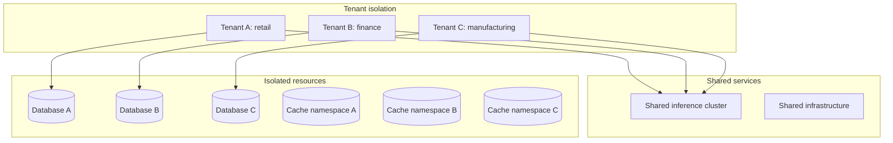
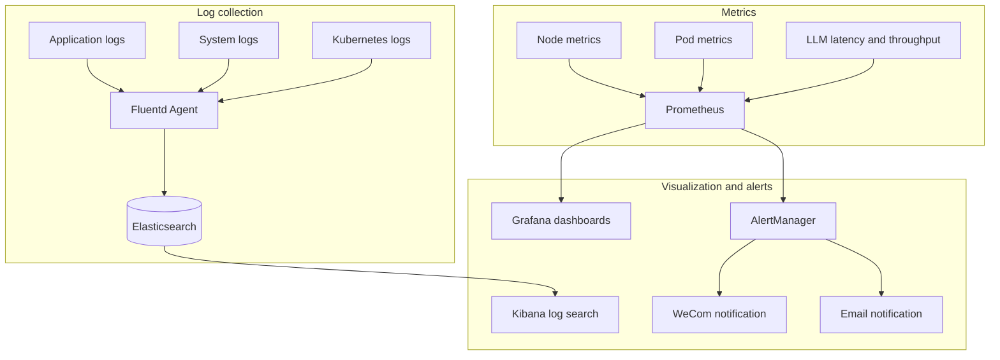
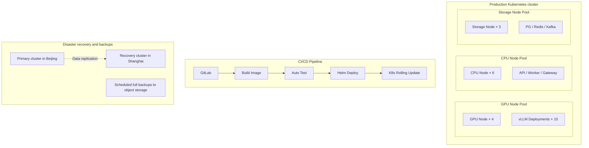

# DataLens AI deployment architecture

This course design targets **100,000 concurrent connections**. The inference budget below allows roughly 100 completed requests per second, with excess requests queued. All capacities and costs are planning estimates.

## 1. Architecture overview

## 2. Service design

### Inference

Run the fine-tuned Qwen3.5-0.8B model with vLLM v0.6+ using PagedAttention and continuous batching. The design assumes about 2 GB of model memory per instance, eight NVIDIA A10 or L20 GPUs per node with 24–48 GB per GPU, optional 4-bit AWQ, and at least ten replicas managed by Kubernetes HPA.

At 5,000 output tokens per GPU-second and 500 tokens per request, each GPU serves about 10 requests per second. Ten replicas serve about 100 requests per second. The proposal assumes a 10–20× throughput improvement with batching, prefix KV-cache sharing across turns, priority for paying customers through a Redis sorted set, and a 5–30 minute cache for common queries such as monthly sales.

### Load balancing and API gateway

Alibaba Cloud DNS or Cloudflare directs global traffic. A CDN serves static files. Nginx or HAProxy distributes TCP connections at layer 4. Kong or APISIX handles authentication, routing, rate limits, logging and plugins. Consul or Kubernetes Services provide discovery and health checks.

The Nginx estimate uses four workers with 65,535 worker connections each. Stateless gateways scale horizontally. Kubernetes can adjust pod counts based on CPU, memory and QPS.

### Data processing

Connectors discover schemas and sample enterprise databases. PostgreSQL holds metadata. Milvus stores embeddings for retrieval. The context builder combines schema and retrieved examples for inference. In a private deployment, processing stays inside the corporate network. The design includes rule-based PII masking and an audit trail of SQL executions.

### Storage

| Service | Purpose | Proposed capacity |
| --- | --- | --- |
| PostgreSQL 14+ | Users, tenants, subscriptions and configuration | Primary and replica, 500 GB SSD |
| ClickHouse | Query logs, aggregates and user behavior | Cluster, 2 TB SSD |
| Redis 7 Cluster | Sessions, rate counters and cached results | Three primaries and three replicas, 64 GB |
| Milvus | Schema vector index | Single node, 128 GB |
| MinIO or S3 | Reports, archived logs and model backups | Expandable object storage |

### Background jobs

Kafka buffers sudden traffic increases and separates incoming requests from slow queries, report generation and log collection. Workers notify Redis when jobs finish. WebSocket connections deliver progress and results to clients.

### Tenant isolation and billing

Each tenant receives a database schema and a Redis namespace. Tenants share the GPU pool. Usage metering counts tokens and API calls.

### Monitoring and operations

| Metric | Proposed action |
| --- | --- |
| P50/P99 inference latency | Alert when P99 exceeds 5 seconds |
| Token throughput | Alert below 50% of baseline |
| API QPS | Scale above 70% of capacity |
| HTTP 5xx rate | Alert above 1% |
| Database connections and slow queries | Alert above 80% connection utilization |
| GPU utilization | Alert below 30% or above 95% |
| Memory or disk usage | Alert above 85% |
| Daily active users | Alert on a 30% decline |

## 3. Capacity planning

| Layer | Per node | Cluster in the proposal | Theoretical capacity listed in the design |
| --- | --- | --- | --- |
| Nginx L4 | 100K connections | Two nodes, active/standby | 200K combined node capacity |
| Kong | 10K QPS | Five nodes | 50K QPS |
| Redis | 100K operations/s | Six nodes | 600K operations/s |
| Kafka | 100K messages/s | Three brokers | 300K messages/s |
| vLLM | 10 requests/s per GPU | Ten GPUs | 100 requests/s plus buffering |

Requests pass through Nginx and Kong to autoscaled backend services and a Kafka buffer. When demand exceeds inference capacity, scale on queue depth, show waiting times to lower-priority users, and use a circuit breaker to return a status message if a downstream service fails.

## 4. Deployment and recovery

The proposed production cluster separates GPU, CPU and storage pools. GitLab builds and tests images, then Helm deploys rolling updates. The design places the primary cluster in Beijing, the recovery cluster in Shanghai, and full backups in object storage.

## 5. Monthly cloud budget

| Resource | Configuration | Estimated monthly cost |
| --- | --- | ---: |
| GPU nodes | Four nodes, eight A10 GPUs each | RMB 32,000 |
| CPU nodes | Six nodes, 32 cores and 64 GB each | RMB 12,000 |
| Storage nodes | Three nodes, 2 TB SSD each | RMB 6,000 |
| Object storage | 10 TB | RMB 2,000 |
| Network | 100 Mbps BGP | RMB 3,000 |
| Kubernetes, monitoring and backups | Other costs | RMB 5,000 |
| Total | | RMB 60,000 |

The proposal estimates monthly infrastructure costs of RMB 12,000 per 1,000 monthly active users.

The original document was drafted with Claude (Anthropic). Its prompts requested an architecture for 100,000 concurrent connections, Mermaid diagrams, capacity and cost estimates, and a design for tenant isolation and billing.
