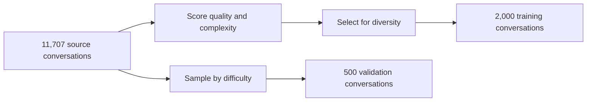

# DataLens Lab

How do you choose 2,000 conversations to teach a small language model about data analysis? This experiment starts with 11,707 conversations from DataMind-12K, fine-tunes Qwen3.5-0.8B with Ray Train, and puts the resulting assistant in a Gradio chat interface for questions about SQL, Python, and statistics.

[Watch the walkthrough · 8 min 53 sec](12311701_张航源.mp4) · [Read the experiment report](12311701_张航源.pdf) · [Explore the training notebook](code_12311701_张航源_raytrain.ipynb)

## Inside the demo

> Explain the difference between L1 and L2 regularization with examples.

*Gradio session captured on page 9 of the [experiment report](12311701_张航源.pdf).* Other example prompts ask for a SQL query to rank customers by total purchases and Python code to plot a correlation matrix.

## Choosing the training data

The selection script estimates complexity from signals such as difficulty, turn count, and code blocks. It uses the 15th percentile of quality scores as a cutoff, ranks candidates by their combined score, and compares TF-IDF vectors using cosine similarity to limit repetition. The validation set is sampled by difficulty level. [Read the selection code](code_12311701_张航源_data_selection.py)

| Selection metric | Source dataset | Training set | Validation set |
| --- | ---: | ---: | ---: |
| Mean complexity score | 0.35 | 0.52 | 0.48 |
| Mean quality score | 0.65 | 0.78 | 0.73 |

## What changed during fine-tuning

Early runs missed the start of some assistant replies in the Qwen3.5 chat template. Those examples had no target tokens for the model to learn from. The revised preprocessing uses character offsets to locate each reply and computes loss only on its tokens. The historical run in the project report took **125 steps** at an effective batch size of **16**, with a final training loss of **0.098**.

| Experiment stage | Source |
| --- | --- |
| Format the conversations | [Data preparation script](code_12311701_张航源_prepare_qwen_data.py) |
| Train the model | [Ray Train notebook](code_12311701_张航源_raytrain.ipynb) |
| Inspect responses | [Inference script](test_inference.py) · [Gradio app](demo.py) |

## Run the offline demo on Windows

The low-memory profile runs locally while the GPU is occupied. Install once with a 64-bit Python 3.11 environment, then start from PowerShell:

~~~powershell
uv venv --python 3.11 .venv-lowmem
uv pip install --python .venv-lowmem/Scripts/python.exe "https://download.pytorch.org/whl/cpu/torch-2.7.1%2Bcpu-cp311-cp311-win_amd64.whl" -r requirements-demo.txt
.\run-demo.cmd --check
.\run-demo.cmd
~~~

Open the local address printed by Gradio (default port 7860). The first CPU launch writes a 2.81 GiB FP32 cache under `runs/cpu-weights/`, keyed by the source weight hash. Later runs map those files read-only. Keep approximately 4 GiB of disk space available on first launch. Activation is optional when using the launcher.

For a separate GPU installation, use a virtual environment named `.venv`, the same requirements and the official Windows `torch==2.7.1+cu118` wheel compatible with that interpreter. Run `.venv/Scripts/python.exe demo.py --device cuda --check` to verify generation before starting the GPU server. When the low-memory environment exists, `run-demo.cmd` selects it. Pass `--port` to choose another loopback port.

The model assets are supplied separately. Point `--model-dir` at a local Qwen3.5-0.8B configuration and `--checkpoint-dir` at a directory containing `model.pt`, `tokenizer.json`, `tokenizer_config.json` and `chat_template.jinja`. The default lookup accepts both the original and ModelScope-escaped model folder names. The recorded demo uses `ray results/qwen-datamind-full/checkpoint_2026-05-24_06-08-05.338158` and weight SHA-256 `5aa2d82d2a51c5ebe99e796d8321565e22b5ee5de9fe4073fd0d688062748697`. The Ray snapshot identifies a different directory for the historical loss of 0.098.

Windows can run out of system commit even when the driver reports free VRAM. Use the low-memory profile when another workload needs the GPU. For a CUDA error, verify that the project interpreter reports `torch.cuda.is_available()`. For an allocation error, free GPU memory and retry the question. The app serves one generation at a time, retains recent turns within a 1,024-token input budget and generates up to 128 new tokens per answer.

### Reproduce the training pipeline

In a separate training environment install PyTorch, Transformers 5.9.0, Datasets, scikit-learn and `ray[train]==2.55.1`. From the project directory:

~~~powershell
python code_12311701_张航源_data_selection.py
python code_12311701_张航源_prepare_qwen_data.py
python train.py --smoke
~~~

Supply `datamind_12k.json` locally. Selection writes split JSON under `runs/selection`; preparation produces a reloadable Arrow dataset under `runs/prepared`. The tiny training run exercises the same worker on real data with five training batches and two validation examples, including a partial gradient accumulation group. Run `python train.py` for the full configuration on a suitable training GPU. To import existing JSONL splits, supply both `--train-jsonl` and `--val-jsonl`. Each training run stores its checkpoint separately from the demo.

### Local verification · November 18, 2026

On the Windows laptop, Python 3.11.15 and PyTorch 2.7.1+cpu served the existing 0.8B checkpoint while another local evaluation was active. Three fresh processes passed the offline startup test with outbound TCP blocked. Each recovered from an injected allocation error and a canceled generation, then produced a SQL count query that returned the expected result in SQLite.

The final decoding settings passed 20 API requests across two independent clients per round, including Chinese questions and SQL follow-ups that reused the preceding table name. A headless Edge session submitted a question, regenerated the answer and cleared the chat. Longer answers can reach the 128-token limit, and generated explanations and code still require review. The full-GPU run encountered a Windows allocation error under the concurrent workload.

The rebuilt splits contained 2,000 training and 500 validation conversations with zero shared IDs. After tokenization, 1,986 and 485 examples respectively had usable shifted targets. The separate two-layer Ray smoke run completed two optimizer steps, produced a validation loss of 12.4404 and reloaded its checkpoint.

To rerun the service checks, start the app and run `python verify_demo.py --browser` from a QA environment containing Playwright, gradio_client and an installed Microsoft Edge browser. For the offline failure-recovery check, stop the running app and run `python tests/verify_start.py` from the demo environment.

## From experiment to product proposal

The second part of the project explores **DataLens AI**, a proposed analytics assistant for business teams. Its architecture targets 100,000 concurrent users as a design goal. The experiment report documents the fine-tuning results, while the pitch deck covers use cases and the business model.

[Architecture](Q2_architecture.md) · [Business plan](Q2_business_plan.md) · [Pitch deck](12311701_张航源DataLens%20AI%20路演PPT.pptx)
