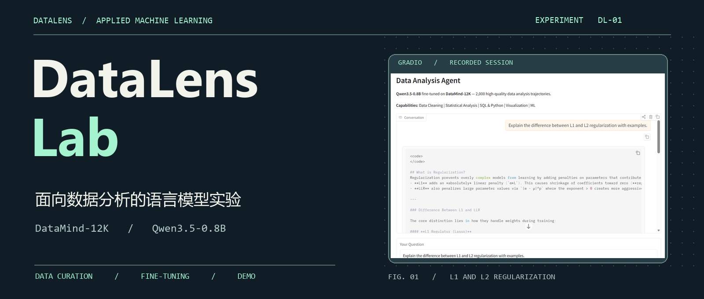
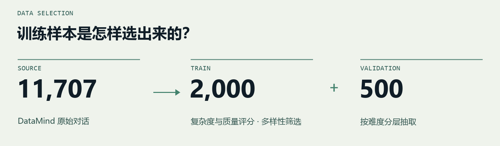

[](12311701_张航源.mp4)

# DataLens Lab

**用 2,000 条精选对话，训练一个能聊 SQL、Python 和统计学的数据分析助手。** 本项目记录了从 DataMind-12K 筛选对话、用 Ray Train 微调 Qwen3.5-0.8B，到在 Gradio 里检验回答的完整实验。

[观看项目讲解 · 8 分 53 秒](12311701_张航源.mp4)　·　[阅读实验报告](12311701_张航源.pdf)　·　[打开训练 Notebook](code_12311701_张航源_raytrain.ipynb)

## 一次真实对话

“Explain the difference between L1 and L2 regularization with examples.” 在这次演示中，用户请模型举例说明两种正则化方法。点击封面可以观看项目讲解，也可以放大查看报告第 9 页记录的[完整对话界面](docs/media/gradio-session.png)。演示还提供了按消费总额查询前十名客户、用 Python 绘制相关性热力图等问题入口。

## 从 11,707 条对话里选什么



筛选脚本先从难度、轮数和代码块等特征估算复杂度，再用质量分的第 15 百分位设置门槛。候选样本按综合得分排序后，脚本用 TF-IDF 余弦相似度控制重复内容。验证集按难度分层抽取。完整规则见[数据筛选脚本](code_12311701_张航源_data_selection.py)。

| 报告中的筛选指标 | 原始数据 | 训练集 | 验证集 |
| --- | ---: | ---: | ---: |
| 平均复杂度评分 | 0.35 | 0.52 | 0.48 |
| 平均质量评分 | 0.65 | 0.78 | 0.73 |

## 微调过程中解决了什么

训练初期，预处理没有正确识别 Qwen3.5 模板中的助手回复边界，导致部分样本缺少有效训练目标。修正后的流程用字符偏移定位助手文本对应的 token，让损失函数只计算模型需要学习的回复。报告记录的最终运行共 **125 步**，有效批量为 **16**，最终**训练损失为 0.098**。

| 顺序 | 可以查看什么 |
| --- | --- |
| 1 · 准备数据 | [转换对话格式](code_12311701_张航源_prepare_qwen_data.py) |
| 2 · 微调模型 | [Ray Train Notebook](code_12311701_张航源_raytrain.ipynb) |
| 3 · 检查回答 | [推理脚本](test_inference.py) · [Gradio 对话入口](demo.py) |

<details>
<summary><strong>在本机启动 Gradio</strong></summary>

公开仓库提供源码和实验记录。运行微调版演示需要自行准备训练检查点，将含有 model.pt 和 tokenizer 文件的 checkpoint_* 目录放在项目下的 `ray results/qwen-datamind-full/`。脚本会选择按名称排序后的最新检查点，首次运行还需从 ModelScope 获取基础模型。

```bash
python -m pip install torch transformers gradio modelscope
python demo.py
```

启动后打开 `http://127.0.0.1:7860`。如需从头训练，还需准备 DataMind-12K 数据并按本机环境调整脚本和 Notebook 中的数据路径。

</details>

## 从实验到产品构想

课程的第二部分将助手扩展为 **DataLens AI** 企业数据分析产品提案。架构文档讨论十万级并发的设计目标，路演材料说明业务场景与商业模式。上述规模属于方案目标，实测训练结果见实验报告。

[系统架构图与设计](Q2_architecture.md)　·　[商业计划书](Q2_business_plan.md)　·　[路演幻灯片](12311701_张航源DataLens%20AI%20路演PPT.pptx)
