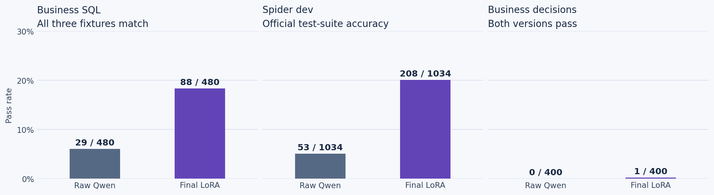
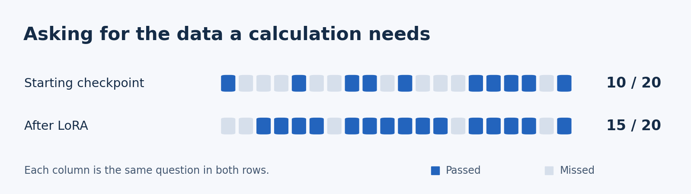

# DataLens Lab

[](#inside-the-demo)

Can a 0.8B-parameter model write a SQL query and recognize when a question is missing the data it needs? DataLens Lab explores both tasks. The project selects 2,000 conversations from DataMind-12K, fine-tunes Qwen3.5-0.8B with Ray Train, and serves the model locally in Gradio.

[Watch the walkthrough (8:53)](12311701_张航源.mp4) · [Read the experiment report](12311701_张航源.pdf) · [Open the training notebook](raytrain.ipynb) · [Run the demo](#run-the-demo-on-windows)

## Checkpoint comparison

**With 128 output tokens, domain fine-tuning raised correct business SQL from 29/480 to 88/480.** Each answer had to return the correct rows on three SQLite fixtures. Of the 480 paired questions, 77 improved and 18 regressed. The gain met the registered ten-point threshold and the confidence interval excluded zero.



| English task | Raw Qwen3.5-0.8B | Final LoRA | Gain in pp [97.5% CI] |
| --- | ---: | ---: | ---: |
| Business SQL · all three fixtures correct | 29/480 | 88/480 | +12.29 [+8.75, +16.04] |
| Spider dev · official execution test suite | 53/1034 | 208/1034 | +14.99 [+10.73, +20.03] |
| Business decisions · both versions correct | 0/400 | 1/400 | +0.25 [+0.00, +1.00] |

**Where SQL improved.** Filters went from 8 to 44 passes out of 80 and date-boundary questions from 0 to 27. Joins fell from 15 to 6. Both models scored 0/80 when the result had to retain groups with zero matches. The candidate returned executable SQL on 209 questions, compared with 71 for raw Qwen. Among the 45 on which both queries ran, the correct counts were 23 and 19, respectively.

**One query, before and after tuning.** The first SQL question by ID on which the candidate improved asked how many different winning pilots appeared at one location. Raw Qwen introduced an extra join and a malformed column reference. The tuned model returned the following query, which passed all three fixtures. [See both original answers](evaluation/domain/RESULTS.md#examples-selected-by-id)

```sql
SELECT COUNT(DISTINCT winning_pilot) FROM match WHERE location='v1';
```

**What happened when data were missing.** To pass a business pair, the model had to request the withheld input and then solve the complete version in a fresh chat. Raw Qwen passed 0/400 pairs and the candidate passed 1/400. This endpoint did not meet the registered improvement threshold.

**How much the answer budget mattered.** On business SQL, raw Qwen reached the 128-token cap on 480/480 answers and the candidate on 1/480. A complete query could still pass if the explanation after it was cut short. On full Spider dev, the cap affected 1,031/1,034 raw answers and 0/1,034 tuned answers. On the same 100-question Spider sample, increasing the budget from 128 to 512 raised raw Qwen from 6 to 9 correct. The candidate scored 22/100 at both budgets.

The final candidate includes both English adaptation stages. Only the raw and final weight files could be verified for these new tests. The Gradio demo still uses its documented demo checkpoint. [Read the results, examples and regressions](evaluation/domain/RESULTS.md) · [Replay the scores](evaluation/domain/README.md) · [Inspect the checkpoint provenance](evaluation/domain/CHECKPOINTS.md)

<details>
<summary>Historical regression check · 20 missing-data questions</summary>

**On 20 held-out English questions with missing data, a second round of domain fine-tuning with LoRA raised the pass rate from 50% to 75%.** The baseline was the checkpoint after the first round of English domain training. To pass, the assistant had to ask for the specific information needed to answer. Both checkpoints saw the same prompts and were graded against the same criteria with model identities hidden.



> **Question** · What share of our returned packages arrived damaged?
>
> **Before** · Could you share dated broken records of the count, and I can use those to answer; otherwise I cannot.
>
> **After LoRA** · Please share the return count and number of damaged returns, along with the definition of a damaged return.

The rate needs two counts from the same group of returns. The baseline asked for records without identifying both counts. The tuned answer named the numerator and denominator.

</details>

<details>
<summary>Checkpoints, scoring and all 44 confirmation questions</summary>

Starting from the merged first-round weights, we trained a rank-16 LoRA adapter on 600 English examples for 38 updates. Its learning rate of 5e-5 was selected on a separate development set. The English confirmation set was fixed before reviewing the answers. This comparison uses one training seed.

| Task | Starting checkpoint | After LoRA |
| --- | ---: | ---: |
| Ask for missing information | 10/20 | 15/20 |
| Generate SQL with the correct result | 5/20 | 7/20 |
| Calculate with all data supplied | 1/4 | 3/4 |

SQL had to match the reference result on two SQLite fixtures. The other answers were scored against predefined criteria. The missing-data result covers single-turn clarification. In the 20 paired answers, six changed from fail to pass and one from pass to fail. The local demo uses the original demo checkpoint.

[Inspect the 44 paired prompts, reference criteria, answers and grades](docs/english-confirmation.csv)

</details>

<details>
<summary>Full fine-tuning vs. LoRA on 24 additional English questions</summary>

The original training run used an effective batch size of 16 and reported a final training loss of 0.098 after 125 steps. A follow-up experiment tested answer quality directly. Starting from the same weights, full fine-tuning and LoRA each used 600 English examples. The table shows passes on a later set of 24 English prompts held back from model selection.

| Fine-tuning method | Learning rate | SQL queries | Ask for missing data | Answer when data is sufficient |
| --- | --- | ---: | ---: | ---: |
| Full parameters | Fixed, 5e-6 | 4/10 | **7/10** | **3/4** |
| Full parameters | Warmup + cosine | **5/10** | 3/10 | **3/4** |
| LoRA (rank 16) | Fixed, 5e-5 | 1/10 | 6/10 | 2/4 |
| LoRA (rank 16) | Warmup + cosine | 1/10 | **7/10** | 2/4 |

The schedule warmed up for four updates and decayed over 34, matching each method’s fixed learning rate on average. With full fine-tuning, it gained one SQL pass but lost four clarification passes. LoRA used 7.10 GiB of peak tensor memory during the scheduled run, compared with 15.81 GiB for full fine-tuning.

SQL was scored by executing queries against two SQLite fixtures. Clarifications and direct answers were reviewed against predefined criteria with model names hidden. These 24 prompts and one training seed support a narrow comparison. The demo still uses its original checkpoint.

</details>

## Inside the demo


The assistant explains row counts with a SQL example. In SQLite, a column containing `10, 10, 20, NULL` gives **4** for `COUNT(*)` and **2** for `COUNT(DISTINCT value)`.

| Try asking | What to look for |
| --- | --- |
| `Given customers(id) and orders(id, customer_id), count orders per customer, including customers with zero orders.` | Does the query keep every customer and return zero for an unmatched order? |
| `Seven packages arrived damaged. What percentage of shipments arrived damaged?` | Does the assistant ask for the total number of shipments before calculating a percentage? |

## Run the demo on Windows

> [!IMPORTANT]
> The public repository contains the code, notebook, report and recorded demo. To run inference, supply a local Qwen3.5-0.8B directory containing `config.json` and a compatible DataLens checkpoint containing `model.pt`, `tokenizer.json`, `tokenizer_config.json` and `chat_template.jinja`. To explore the project without weights, start with the [walkthrough](12311701_张航源.mp4).

From the repository root, install the CPU environment with **uv** and **64-bit Python 3.11**. Allow about 4 GiB of free disk space for the first launch to build the CPU weight cache.

```powershell
uv venv --python 3.11 .venv-lowmem
uv pip install --python .venv-lowmem/Scripts/python.exe "https://download.pytorch.org/whl/cpu/torch-2.7.1%2Bcpu-cp311-cp311-win_amd64.whl" -r requirements-demo.txt
```

Replace the two example paths below. The first command using `--check` loads the checkpoint and generates a response. Once it succeeds, start the chat and open the local address printed by Gradio (default `http://127.0.0.1:7860`).

```powershell
$model = 'D:\models\Qwen3.5-0.8B'
$checkpoint = 'D:\models\datalens-checkpoint'
.\run-demo.cmd --model-dir $model --checkpoint-dir $checkpoint --check
.\run-demo.cmd --model-dir $model --checkpoint-dir $checkpoint
```

The CPU launcher reuses the weight cache on later starts. Pass `--port 7861` if the default port is occupied. For a GPU environment with CUDA-enabled PyTorch and the [demo dependencies](requirements-demo.txt), invoke `demo.py` with `--device cuda` and the same model paths.

## How the training data was built

| Stage | What happens |
| --- | --- |
| [Select conversations](data_selection.py) | Score 11,707 conversations for quality and complexity. Use TF-IDF similarity to limit repetition when selecting 2,000 training conversations. Reserve 500 separate examples for validation. |
| [Prepare the splits](prepare_qwen_data.py) | Convert message lists into chat trajectories and save both splits as an Arrow dataset. |
| [Train and validate](train.py) | Apply the Qwen chat template and use token offsets to supervise assistant replies. Drop examples that have no prediction targets after truncation. Save the weights and tokenizer together. |

To reproduce the pipeline, supply `datamind_12k.json` in the repository root and a local **base model with weights and tokenizer**. Use a separate training environment with PyTorch, Transformers 5.9.0, Datasets, NumPy, scikit-learn and `ray[train]==2.55.1`.

```powershell
python data_selection.py
python prepare_qwen_data.py
python train.py --model-dir $model --smoke
```

The smoke run trains a small two-layer model on CPU and reloads its checkpoint. To fine-tune the full base model on a suitable GPU, run `python train.py --model-dir $model`. Training runs write to `runs/training/`. See the [Ray Train notebook](raytrain.ipynb) for the original experiment.

## Project materials

- **Demo verification** · The [offline startup check](tests/verify_start.py) exercises generation and recovery. The [service checks](verify_demo.py) test the running Gradio app through its API and optionally Microsoft Edge.
- **Product proposal** · DataLens AI explores how the local prototype could serve business teams. The [architecture](Q2_architecture.md), [business plan](Q2_business_plan.md) and [pitch deck](12311701_张航源DataLens%20AI%20路演PPT.pptx) describe the proposed service.
