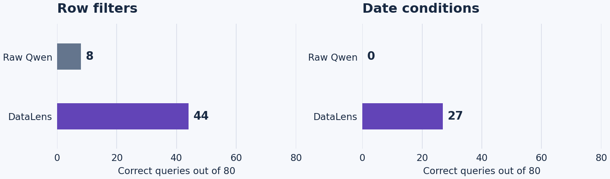
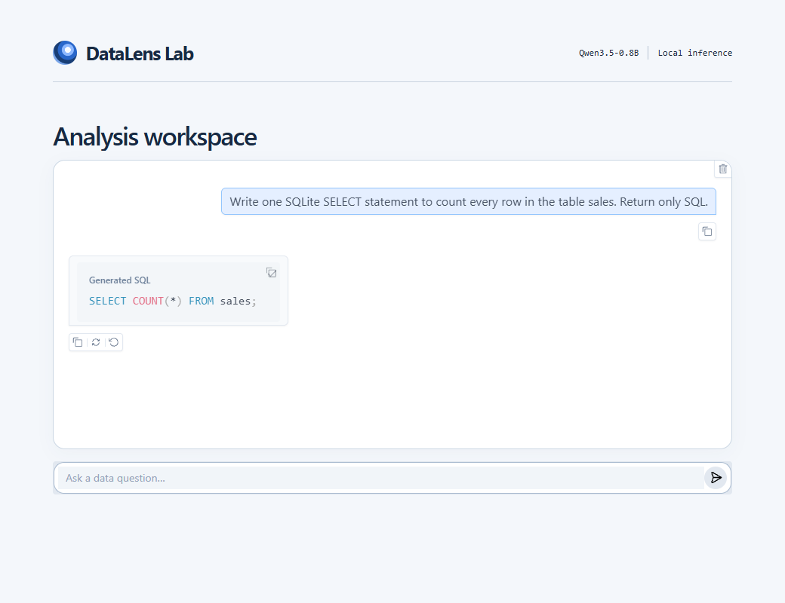

# DataLens Text-to-SQL

[](#inside-the-demo)

DataLens Lab fine-tunes Qwen3.5-0.8B to turn English questions into SQLite queries. The project includes a Ray Train pipeline built on 2,000 selected DataMind-12K conversations, a local Gradio demo and paired execution tests against the raw model.

[Watch the walkthrough (8:53)](12311701_张航源.mp4) · [Read the experiment report](12311701_张航源.pdf) · [Open the training notebook](raytrain.ipynb) · [Run the demo](#run-the-demo-on-windows)

## Checkpoint comparison

**With the same 128-token answer budget, DataLens returned the correct result on 88 of 480 business SQL questions. Raw Qwen answered 29 correctly.** Each generated query had to return the expected rows on three different SQLite fixtures. The same two checkpoints also ran on the full Spider 1.0 development set.

| English text-to-SQL benchmark | Raw Qwen3.5-0.8B | DataLens (final LoRA) | Gain in percentage points (97.5% CI) |
| --- | ---: | ---: | ---: |
| Business SQL · 80 databases | 29/480 (6.0%) | **88/480 (18.3%)** | +12.29 [8.75, 16.04] |
| Spider dev · official execution tests | 53/1,034 (5.1%) | **208/1,034 (20.1%)** | +14.99 [10.73, 20.03] |

### Where tuning helped most

Filtering rows and applying date conditions showed the largest gains among the six business SQL task families. Each family had one question per database.



For example, one question asked how many mills had a `built_year` of 2024. Raw Qwen changed the year to 2025 and asked for the data file. DataLens used the requested year and returned a query that passed on all three fixtures. [Both recorded answers](evaluation/domain/results/confirm-b-answers.jsonl#L17)

```sql
SELECT COUNT(*) FROM mill WHERE built_year=2024;
```

Short answers matter under a token limit. When both models were given **512 tokens** on the same 100-question Spider sample, DataLens still passed **22/100** and raw Qwen passed **9/100**. The comparison measures the combined effect of both English fine-tuning stages. The Gradio walkthrough below uses the original demo checkpoint. [Full evaluation across all tasks](evaluation/domain/RESULTS.md) · [Reproduce the scores](evaluation/domain/README.md) · [Checkpoint details](evaluation/domain/CHECKPOINTS.md)

## Inside the demo



The assistant explains row counts with a SQL example. In SQLite, a column containing `10, 10, 20, NULL` gives **4** for `COUNT(*)` and **2** for `COUNT(DISTINCT value)`.

## Run the demo on Windows

> [!IMPORTANT]
> The public repository contains the code, notebook, report and recorded demo. To run inference, supply a local Qwen3.5-0.8B directory containing `config.json` and a compatible DataLens checkpoint containing `model.pt`, `tokenizer.json`, `tokenizer_config.json` and `chat_template.jinja`. To explore the project without weights, start with the [walkthrough](12311701_张航源.mp4).

From the repository root, install the CPU environment with **uv** and **64-bit Python 3.11**. Allow about 4 GiB of free disk space for the first launch to build the CPU weight cache.

```powershell
uv venv --python 3.11 .venv-lowmem
uv pip install --python .venv-lowmem/Scripts/python.exe "https://download.pytorch.org/whl/cpu/torch-2.7.1%2Bcpu-cp311-cp311-win_amd64.whl" -r requirements-demo.txt
```

Replace the two example paths below. The first command using `--check` loads the checkpoint and generates a response. Once it succeeds, start the chat and open the local address printed by Gradio (default `http://127.0.0.1:7860`).

```powershell
$model = 'D:\models\Qwen3.5-0.8B'
$checkpoint = 'D:\models\datalens-checkpoint'
.\run-demo.cmd --model-dir $model --checkpoint-dir $checkpoint --check
.\run-demo.cmd --model-dir $model --checkpoint-dir $checkpoint
```

The CPU launcher reuses the weight cache on later starts. Pass `--port 7861` if the default port is occupied. For a GPU environment with CUDA-enabled PyTorch and the [demo dependencies](requirements-demo.txt), invoke `demo.py` with `--device cuda` and the same model paths.

## How the training data was built

| Stage | What happens |
| --- | --- |
| [Select conversations](data_selection.py) | Score 11,707 conversations for quality and complexity. Use TF-IDF similarity to limit repetition when selecting 2,000 training conversations. Reserve 500 separate examples for validation. |
| [Prepare the splits](prepare_qwen_data.py) | Convert message lists into chat trajectories and save both splits as an Arrow dataset. |
| [Train and validate](train.py) | Apply the Qwen chat template and use token offsets to supervise assistant replies. Drop examples that have no prediction targets after truncation. Save the weights and tokenizer together. |

To reproduce the pipeline, supply `datamind_12k.json` in the repository root and a local **base model with weights and tokenizer**. Use a separate training environment with PyTorch, Transformers 5.9.0, Datasets, NumPy, scikit-learn and `ray[train]==2.55.1`.

```powershell
python data_selection.py
python prepare_qwen_data.py
python train.py --model-dir $model --smoke
```

The smoke run trains a small two-layer model on CPU and reloads its checkpoint. To fine-tune the full base model on a suitable GPU, run `python train.py --model-dir $model`. Training runs write to `runs/training/`. See the [Ray Train notebook](raytrain.ipynb) for the original experiment.

## Project materials

- **Demo verification** · The [offline startup check](tests/verify_start.py) exercises generation and recovery. The [service checks](verify_demo.py) test the running Gradio app through its API and optionally Microsoft Edge.
- **Product proposal** · DataLens AI explores how the local prototype could serve business teams. The [architecture](Q2_architecture.md), [business plan](Q2_business_plan.md) and [pitch deck](12311701_张航源DataLens%20AI%20路演PPT.pptx) describe the proposed service.
