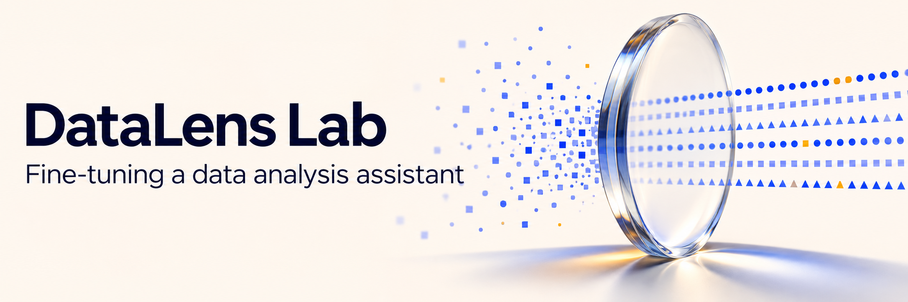
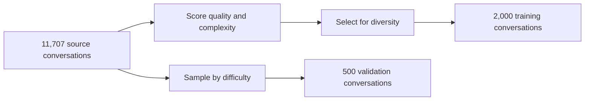

[](12311701_张航源.mp4)

# DataLens Lab

How do you choose 2,000 conversations to teach a small language model about data analysis? This experiment starts with 11,707 conversations from DataMind-12K, fine-tunes Qwen3.5-0.8B with Ray Train, and puts the resulting assistant in a Gradio chat interface for questions about SQL, Python, and statistics.

[Watch the walkthrough · 8 min 53 sec](12311701_张航源.mp4) · [Read the experiment report](12311701_张航源.pdf) · [Explore the training notebook](code_12311701_张航源_raytrain.ipynb)

## Inside the demo

> Explain the difference between L1 and L2 regularization with examples.

Page 9 of the report captures the assistant answering this prompt. Other example prompts ask for a SQL query to rank customers by total purchases and Python code to plot a correlation matrix. [View the recorded Gradio session](docs/media/gradio-session.png)

## Choosing the training data



The selection script estimates complexity from signals such as difficulty, turn count, and code blocks. It uses the 15th percentile of quality scores as a cutoff, ranks candidates by their combined score, and compares TF-IDF vectors using cosine similarity to limit repetition. The validation set is sampled by difficulty level. [Read the selection code](code_12311701_张航源_data_selection.py)

| Selection metric | Source dataset | Training set | Validation set |
| --- | ---: | ---: | ---: |
| Mean complexity score | 0.35 | 0.52 | 0.48 |
| Mean quality score | 0.65 | 0.78 | 0.73 |

## What changed during fine-tuning

Early runs missed the start of some assistant replies in the Qwen3.5 chat template. Those examples had no target tokens for the model to learn from. The revised preprocessing uses character offsets to locate each reply and computes loss only on its tokens. The final run took **125 steps** at an effective batch size of **16**, with a final training loss of **0.098**.

| Experiment stage | Source |
| --- | --- |
| Format the conversations | [Data preparation script](code_12311701_张航源_prepare_qwen_data.py) |
| Train the model | [Ray Train notebook](code_12311701_张航源_raytrain.ipynb) |
| Inspect responses | [Inference script](test_inference.py) · [Gradio app](demo.py) |

<details>
<summary><strong>Run the Gradio demo locally</strong></summary>

Bring a fine-tuned checkpoint containing `model.pt` and its tokenizer files. Place the `checkpoint_*` directory under `ray results/qwen-datamind-full/` in the project root. The app loads the last checkpoint in filename order and can download the base model from ModelScope on first use.

```bash
python -m pip install torch transformers gradio modelscope
python demo.py
```

Open `http://127.0.0.1:7860`. To train from scratch, supply the DataMind-12K dataset and update the paths in the scripts and notebook for your environment.

</details>

## From experiment to product proposal

The second part of the project explores **DataLens AI**, a proposed analytics assistant for business teams. Its architecture targets 100,000 concurrent users as a design goal. The experiment report documents the fine-tuning results, while the pitch deck covers use cases and the business model.

[Architecture](Q2_architecture.md) · [Business plan](Q2_business_plan.md) · [Pitch deck](12311701_张航源DataLens%20AI%20路演PPT.pptx)
